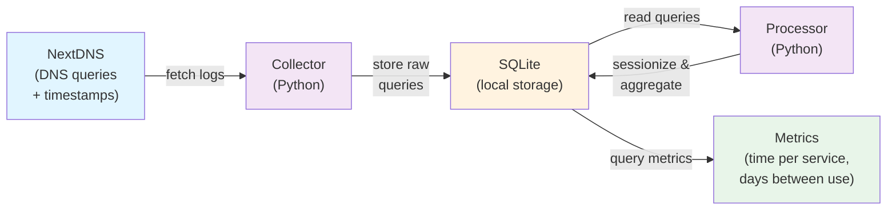
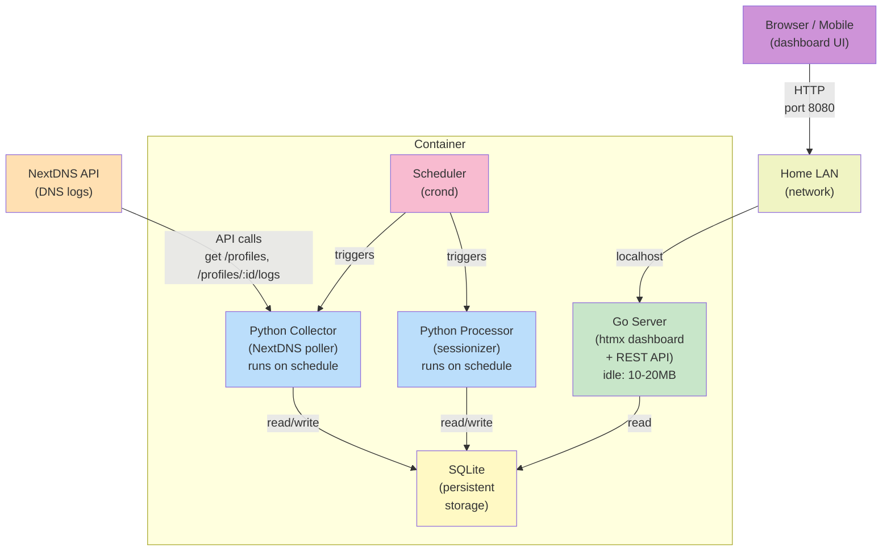
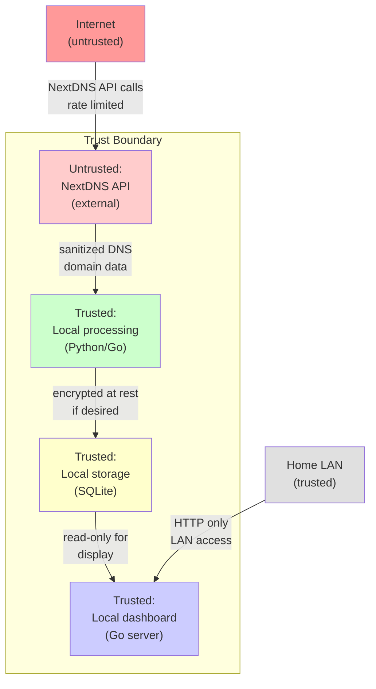
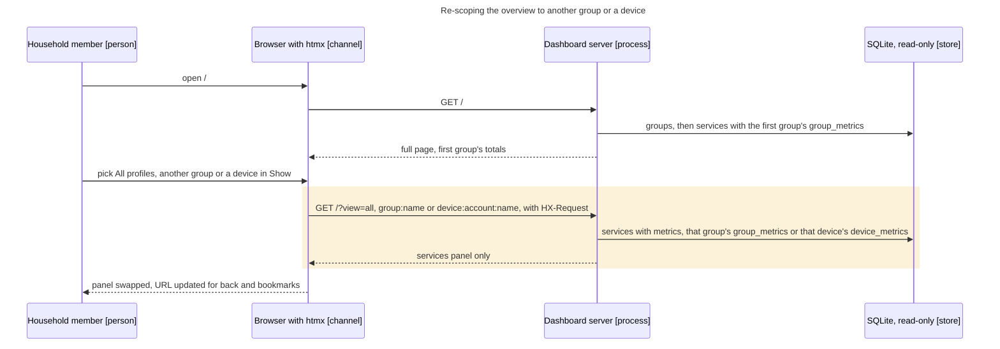

# Sverdrup Architecture

## Overview

Sverdrup is a containerized streaming-service usage measurement system. It collects DNS query logs from NextDNS, processes them into viewing sessions, stores them in SQLite, and serves analytics and insights via a lightweight web dashboard.

The system is designed for home deployment: minimal idle footprint (~10-20MB), mobile-friendly interface, and no external dependencies beyond NextDNS. It can eventually evolve to act as a local DNS server or support additional data sources.

## Design Principles

- **Low idle footprint:** Long-running server is Go (minimal memory); batch jobs are Python (cost only when running)
- **Self-contained:** Single container with all components; SQLite holds all data
- **Privacy-first:** Data never leaves your network; all processing is local
- **LAN-only by default:** Dashboard accessible only on local network, with option for reverse-proxy deployment
- **Incremental:** Backfills NextDNS history on first run, then polls incrementally; local storage becomes the long-term archive

## System Architecture

The system has three main layers: collection, processing, and presentation.

### Data Layer

The data flow from NextDNS through to metrics:



**Data model:**
- **Queries table:** account, profile_id, timestamp, device_name, device_id, device_model, domain_queried, raw_json (the full NextDNS event), plus dedup_key, processed and service_id for the pipeline
- **Sessions table:** service_id, account, profile_ids, device_names, start_time, end_time, session_length_minutes (sessionized queries grouped by service within an account, and gaps; profile_ids and device_names list every profile and device the session touched)
- **Services table:** service_code (netflix, spotify, etc.), service_name, domains (JSON list of DNS domains to match)
- **Metrics table:** service_id, account, profile_id, date, total_minutes, session_count, last_seen (one row per service, profile and local day, so the per-profile breakdown stays queryable)
- **Device sessions and device metrics tables:** the same derivations keyed by NextDNS device as well (service_id, account, device_name, ...), so time per service can be sliced by device. Household totals come from the sessions and metrics tables, never from summing these
- **Profiles table:** profile_id, account, name, updated_at (every profile the collector collects, with its NextDNS name)
- **Profile groups:** `profile_groups` (name, position, rule, entries: each group from `SVERDRUP_GROUPS` as configured) and `group_members` (group_name, profile_id: the profiles it resolved to on the last processor run)
- **Group sessions and group metrics tables:** the same derivations per profile group (service_id, group_name, ...), sessionized from only the group's profiles' queries, so concurrent viewing in two of a group's profiles counts once
- **Metadata table:** key/value pairs such as per-profile `profile:<id>:latest_timestamp` and `profile:<id>:backfill_completed_at`

The schema lives in `sverdrup/db.py`, is created idempotently (`CREATE ... IF NOT EXISTS`) by whichever job runs first, and is shared by the collector and processor.

```mermaid
---
title: Sverdrup SQLite schema
---
erDiagram
    services ||--o{ queries : "classifies"
    services ||--o{ sessions : "groups"
    services ||--o{ metrics : "aggregates"
    services ||--o{ device_sessions : "groups by device"
    services ||--o{ device_metrics : "aggregates by device"
    services ||--o{ group_sessions : "groups by profile group"
    services ||--o{ group_metrics : "aggregates by profile group"
    profiles ||--o{ queries : "logs"
    profile_groups ||--o{ group_members : "resolves to"
    profiles ||--o{ group_members : "belongs to"
    profile_groups ||--o{ group_metrics : "aggregates"
    queries {
        int id PK
        text account
        text profile_id
        text timestamp "UTC, ms precision"
        text device_name "name, else ID, else unidentified"
        text device_id
        text device_model
        text domain_queried
        text raw_json
        text dedup_key UK
        int processed
        int service_id FK "null when no service matches"
    }
    profiles {
        text profile_id PK
        text account
        text name "NextDNS name"
        text updated_at
    }
    profile_groups {
        text name PK
        int position "first is the default view"
        text rule "include or exclude"
        text entries "JSON array, IDs or names"
    }
    group_members {
        text group_name PK
        text profile_id PK
    }
    group_sessions {
        int id PK
        int service_id FK
        text group_name
        text profile_ids "JSON array, profiles touched"
        text device_names "JSON array, devices touched"
        text start_time
        text end_time
        real session_length_minutes
    }
    group_metrics {
        int id PK
        int service_id FK
        text group_name
        text date "local calendar day"
        real total_minutes
        int session_count
        text last_seen
    }
    services {
        int id PK
        text service_code UK
        text service_name
        text domains "JSON array"
    }
    sessions {
        int id PK
        int service_id FK
        text account
        text profile_ids "JSON array, profiles touched"
        text device_names "JSON array, devices touched"
        text start_time
        text end_time
        real session_length_minutes
    }
    metrics {
        int id PK
        int service_id FK
        text account
        text profile_id
        text date "local calendar day"
        real total_minutes
        int session_count
        text last_seen
    }
    device_sessions {
        int id PK
        int service_id FK
        text account
        text device_name
        text profile_ids "JSON array, profiles touched"
        text start_time
        text end_time
        real session_length_minutes
    }
    device_metrics {
        int id PK
        int service_id FK
        text account
        text device_name
        text date "local calendar day"
        real total_minutes
        int session_count
        text last_seen
    }
```



**Figure.** Every stored DNS query keeps its account, profile and device, and household, per-device and per-group sessions and daily metrics are all derived from the queries that match a service.

Lifetime and cross-profile figures are not stored; they are aggregations of `metrics` (for example `SUM(total_minutes)`, `SUM(session_count)` and `MAX(last_seen)` grouped by service and date).

### Infrastructure Layer

Deployment and runtime architecture:



**Key properties:**
- **Single container image:** Go binary, Python scripts, SQLite database
- **Scheduler:** crond manages collector and processor execution on a fixed interval (e.g., every 15 minutes for collector, hourly for processor)
- **Go server:** Always-on, stateless, reads from SQLite
- **Separation of concerns:** Collector handles API polling; processor handles data transformation; server handles query and presentation
- **Entrypoint script:** Container startup runs both crond (background) and Go server (foreground) so scheduled jobs execute within the container

### Security and Trust Layer



**Security properties:**
- **External input validation:** NextDNS API responses are validated before storage
- **No credentials in container:** NextDNS API keys (one per account) and the API URL are environment variables, passed at runtime from an env file; the collector never logs a key and redacts one if anything tries
- **Local-only by default:** Dashboard listens on localhost; accessible only on home LAN
- **Reverse-proxy ready:** Can be placed behind a reverse proxy for broader access (authentication is the proxy's responsibility)
- **No external data export:** All data remains on local storage; no phoning home

## Components

### 1. Collector (Python)

**Responsibility:** Fetch DNS logs from NextDNS API, backfill history on first run, poll incrementally.

**Runtime:** Scheduled job (Python script invoked every 15 minutes by crond)

**Inputs:**
- NextDNS API endpoint (env var: `NEXTDNS_API_URL`)
- NextDNS accounts (env var: `SVERDRUP_ACCOUNTS`, comma-separated short names such as `home,family`)
- For each account `NAME` (uppercased in the variable name): its API key (`NEXTDNS_<NAME>_API_KEY`) and, optionally, the only profile IDs to collect (`NEXTDNS_<NAME>_PROFILES`, comma-separated)

**Profile discovery:** each run first lists the profiles every account's key can see (`GET /profiles`, following its pagination cursor). An account without a profile list collects all of them; an account with one collects exactly its list, as before discovery existed, so an existing configuration keeps its behavior, and a listed profile the key cannot see is logged as a warning. A profile visible to two keys is collected once: by the account that lists it, else by the first account in `SVERDRUP_ACCOUNTS` that sees it. If listing fails, an account without a list is skipped for that run (exit code 2); an account with a list collects its list without refreshing names. Each collected profile is upserted into the `profiles` table with its account and NextDNS name (a name the run did not learn keeps the stored one).

Startup validation is strict and reports every problem at once, naming the variable: a missing key, an empty or duplicate profile ID (also across accounts), a bad account name, and the retired single-account variables `NEXTDNS_API_KEY`/`NEXTDNS_PROFILE_ID`. Messages never include a key.

**Outputs:**
- SQLite `profiles` table: `profile_id, account, name, updated_at`
- SQLite `queries` table: columns `id, account, profile_id, timestamp, device_name, device_id, device_model, domain_queried, raw_json, dedup_key` (the processor owns `processed` and `service_id`)

**Algorithm (per collected profile):**
1. If the profile has no stored rows: backfill all available logs (up to the retention window)
2. Otherwise: poll from the profile's last stored timestamp, minus a 10-minute overlap so late-arriving entries are not missed
3. Request pages oldest-first (`sort=asc`, `limit=1000`), following the pagination cursor. NextDNS never ends oldest-first paging: past the newest entry it keeps returning an empty page with the same cursor, so the collector stops at the first empty page, or when the cursor comes back unchanged
4. Insert each page with `INSERT OR IGNORE` on a unique `dedup_key` and commit it, then update the profile's earliest/latest timestamps in metadata. Each page's transaction takes the write lock up front (`BEGIN IMMEDIATE`), so it waits out the processor's rebuild under the busy timeout instead of failing
5. When paging stops, record the profile's `last_collect_at`, and its `backfill_completed_at` if that is unset (so a backfill that was interrupted and finished by a later incremental run still counts as complete); exit (memory released)

**Error handling:**
- API rate limits: exponential backoff on HTTP 429 and 5xx (2s, 4s, 8s, ... capped at 300s, `Retry-After` honored), up to 6 retries
- Network errors, other HTTP errors and a locked database: log, stop that profile, continue with the others; the run exits non-zero and the next scheduled run resumes
- Invalid data: lowercase and validate domains and timestamps, skip malformed entries, log a count
- Overlapping runs: a lock file next to the database makes a second run exit immediately

### 2. Processor (Python)

**Responsibility:** Sessionize DNS queries into viewing sessions; compute and cache metrics.

**Runtime:** Scheduled job (Python script invoked hourly by crond)

**Inputs:**
- SQLite `queries` table

**Outputs:**
- SQLite `sessions` table: columns `id, service_id, account, profile_ids, device_names, start_time, end_time, session_length_minutes`
- SQLite `metrics` table: columns `id, service_id, account, profile_id, date, total_minutes, session_count, last_seen`
- SQLite `device_sessions` and `device_metrics` tables: the device slice, keyed by `service_id, account, device_name`
- SQLite `profile_groups`, `group_members`, `group_sessions` and `group_metrics` tables: each profile group, its resolved members, and its sessions and daily metrics, keyed by `service_id, group_name`

**Configuration:** `SESSION_GAP_MINUTES` (default 15), `TZ` (IANA zone that defines calendar days; default UTC), and the optional profile groups: `SVERDRUP_GROUPS` (comma-separated names) with, per group `NAME`, either `SVERDRUP_GROUP_<NAME>_PROFILES` (the profiles in it) or `SVERDRUP_GROUP_<NAME>_EXCLUDE` (every profile except these). Entries are profile IDs or NextDNS names (case-insensitive). A malformed group stops the processor with every problem named.

**Algorithm:**
1. Read unprocessed queries from `queries` table
2. For each query, match domain to a streaming service using a domain-to-service mapping; store the match and mark the query processed. If the services table or the excluded hosts have changed since the last run, reclassify every query
3. Group consecutive matched queries (same service, same account, any profile, any device) into sessions, using the gap threshold: a gap longer than the threshold starts a new session; a gap exactly equal to it does not. Profile and device never split a session: NextDNS is usually set up at the router, so the logged device is unreliable, and profiles are many-to-many with clients (a client can move onto a VPN profile mid-viewing). Each session records every profile and device it touched
4. Calculate session length in minutes (last query minus first query)
5. Aggregate by service, profile and local day: sum total_minutes, count sessions, take the latest matched query as last_seen (or, for a day that has minutes but no matched query, such as a profile segment crossing midnight, the end of the latest minutes credited that day). Within a session, the time between two queries belongs to the profile of the earlier query, and the session counts once, under the profile it started in
6. Device slice: repeat steps 3-5 per account, service and NextDNS device (sessions split by device, minutes per device and local day). Queries without a device go to an explicit `unidentified` bucket rather than being dropped
7. Groups: resolve each group against the known profiles (the `profiles` table plus every profile with stored queries); an exclusion group is every known profile minus its entries, so profiles discovered later join it. Log any entry that matches no profile. Then repeat steps 3-5 per group and service over only the members' queries, across accounts and ignoring profile and device, with no per-profile split: concurrent viewing in two member profiles merges into one session, and queries from non-members never join or bridge a group's sessions
8. Replace the `sessions`, `metrics`, `device_sessions`, `device_metrics`, `profile_groups`, `group_members`, `group_sessions` and `group_metrics` tables with the result in one transaction; exit

Steps 3-8 recompute from every matched query on each run rather than appending, so re-running never double-counts and late-arriving queries join the right session.

**Domain mappings** (the seed list in `sverdrup/services.py`; a domain also matches all of its subdomains, on whole labels, and the most specific domain wins):
- Netflix: `netflix.com`, `netflix.net`, `nflxvideo.net`, `nflximg.net`, `nflxext.com`, `nflxso.net`
- Spotify: `spotify.com`, `scdn.co`, `pscdn.co` (covers `audio-sp-*.pscdn.co`), `spotifycdn.com`, `spotifycdn.net`
- Disney+: `disneyplus.com`, `disney-plus.net`, `bamgrid.com`, `dssott.com`
- YouTube: `youtube.com`, `youtu.be`, `googlevideo.com`, `ytimg.com`, except `accounts.youtube.com` (see excluded hosts below)
- Apple TV+: `tv.apple.com` only, so `ocsp.apple.com` certificate checks are not counted
- HBO Max: `hbomax.com`, `max.com`
- Paramount+: `paramountplus.com`, `cbsaavideo.com`
- Prime Video: `primevideo.com`, `aiv-cdn.net`, `aiv-delivery.net`, `amazon.com` (ambiguous; see limitations below)

**Excluded hosts** (`EXCLUDED_DOMAINS` in `sverdrup/services.py`): a host on this list, and its subdomains, match no service even though they sit under a service domain. The most specific listed suffix decides, so a service domain beneath an excluded one still matches. Changing the list reclassifies every stored query on the next processor run.
- `accounts.youtube.com`: Google's signed-in pages (Gmail, Calendar, Chat) refresh its cookies about every 10 minutes whether or not YouTube is open. In the 2026-10-08 calibration it chained an idle Google tab into a 227.6-minute YouTube session for 60.3 minutes actually watched; excluded, the session measured 62.0 minutes.

`braintree-api.com` from the original sketch is left out: it is a payment processor that many unrelated sites use, so it would attribute their traffic to Disney+.

**Note on Amazon Prime Video:** Queries to `amazon.com` and related domains are inherently ambiguous (shopping, AWS, video, email, etc.). The design can tag them but will overcount actual video usage. Mitigation: use device-name or time-of-day heuristics, or accept the limitation in the initial version.

### 3. Dashboard Server (Go + htmx)

**Responsibility:** Serve a mobile-friendly web dashboard and REST API for metrics.

**Runtime:** Always-on container process; listens on port 8080 (configurable)

**Inputs:**
- SQLite `services`, `metrics`, `sessions`, `device_metrics`, `device_sessions`, `profiles`, `profile_groups`, `group_members`, `group_metrics` and `group_sessions` tables, read-only. A database from before profile groups (no `profiles` or group tables until the next collector or processor run) renders without groups and with profile IDs for names
- `DB_PATH` (default `/data/sverdrup.db`), `DASHBOARD_PORT` (default 8080) and `TZ`, which should match the processor's

**Outputs:**
- HTTP/HTML responses (dashboard UI)
- JSON API endpoints for metric queries

**Key features:**
- **Scope:** every view shows one scope: a profile group, "All profiles" (the account-wide household figures) or, on the home page, one NextDNS device. With groups configured the default is the first group in `SVERDRUP_GROUPS`; otherwise it is all profiles. Pages and the API take `?group=<name>` (case-insensitive) or `?group=all`, and the home page and services API also `?device=account:device_name`; an unknown group is a 400
- **Home page (`/`):** Time and sessions this week and this month in the scope, each service's time this week, this month and all time, a per-profile table (each profile's name, account, groups and minutes) with each group's definition, and a per-device table. The Show selector (`?view=group:<name>`, `all` or `device:account:device_name`) re-scopes the summary; htmx swaps just that panel
- **Service detail page (`/services/{id}`):** In the scope (group links above the cards), time per day for the last 30, 90 or 365 days (sparkline + table), median days between use, a per-device table and the 50 most recent sessions. Cost per hour is not built yet: nothing stores subscription prices
- **Session history:** Recent viewing sessions in the scope (a group's own sessions, or the account-wide ones) with start and end times (shown in the server's `TZ`), duration, devices and profiles by NextDNS name
- **Mobile responsive:** Works on phone browser without zoom; less important columns hide on narrow screens
- **API endpoints** (JSON; errors are `{"error": "..."}` with status 400, 404 or 503):
  - `GET /api/services[?group=<name>|all][&device=account:device_name]` — every service with total, this-week and this-month minutes and sessions, active days, first and last date and last seen, plus the period's `today`, `week_start` and `month_start`; every scoped response also carries `scope` (`group`, `all` or `device`), `group` and `device`
  - `GET /api/services/{id}/metrics?start=YYYY-MM-DD&end=YYYY-MM-DD[&group=...|&device=...]` — one entry per day, zeros included; `end` defaults to today and `start` to 29 days before `end`, and a range is at most 3660 days
  - `GET /api/sessions?service={id}&limit=50[&group=...]` — the latest sessions, newest first; `service` is optional (all services when omitted), `limit` is 1-500 and defaults to 50. Each session has `profile_ids` and `profile_names`, and `group` (group scope) or `account` (all profiles)
  - `GET /api/devices` — every NextDNS device with its totals, keyed `account:device_name`
  - `GET /api/groups` — the `default` group and every group with its rule, configured entries and resolved member profiles (`id`, `name`, `account`)
  - `GET /api/profiles` — every profile with its name, account, groups and per-profile totals
  - `GET /health` — liveness, without touching the database

**Framework:** Go's `net/http` + htmx for interactivity (no build step required)



**Figure.** The overview opens on the first configured group; choosing another scope replaces only the summary panel, and the URL keeps the choice, so the same view loads without JavaScript.

**Session replay (future):** Can optionally store and replay "last session" times per device to infer what was watched

## Configuration and Deployment

### Environment Variables

The container expects these at runtime:

```
SVERDRUP_ACCOUNTS=home,family                # NextDNS accounts, as short names
NEXTDNS_HOME_API_KEY=<key>                   # API key of account "home"; collects every profile it sees
NEXTDNS_FAMILY_API_KEY=<key>                 # one key per account
NEXTDNS_FAMILY_PROFILES=<id3>                # optional: collect only these for "family"
SVERDRUP_GROUPS=HapLan                       # optional profile groups; the first is the default view
SVERDRUP_GROUP_HAPLAN_EXCLUDE=Julie,Cumberland,calibration  # every profile but these (or _PROFILES=...)
NEXTDNS_API_URL=https://api.nextdns.io      # NextDNS API endpoint
COLLECTOR_INTERVAL=15                        # minutes between collection runs
PROCESSOR_INTERVAL=60                        # minutes between processing runs (see Scheduling below)
SESSION_GAP_MINUTES=15                       # gap that ends a viewing session
TZ=UTC                                       # IANA time zone that defines a metrics day
DASHBOARD_PORT=8080                          # port for Go server
DB_PATH=/data/sverdrup.db                    # SQLite database path (inside container)
```

All of these go in one env file (`.env`, see `.env.example`), passed with `--env-file` or Compose `env_file`.

### LAN-Only (Default)

Container runs inside your home network. Dashboard is accessible at `http://localhost:8080` from any device on the LAN.

```
$ docker run --rm -d \
  --env-file .env \
  -v $(pwd)/data:/data \
  -p 8080:8080 \
  sverdrup:latest
```

### Reverse Proxy (Optional)

Place the container behind a reverse proxy (nginx, Caddy) with authentication (Basic Auth, OAuth2, or similar) for internet access.

```
# Example nginx config (simplified)
server {
    listen 443 ssl http2;
    server_name streaming.example.com;
    
    auth_basic "Sverdrup";
    auth_basic_user_file /etc/nginx/.htpasswd;
    
    location / {
        proxy_pass http://sverdrup:8080;
    }
}
```

### Future: Local DNS Server

Once mature, Sverdrup could act as a DNS forwarder/resolver on the home network, eliminating the NextDNS dependency and capturing all DNS queries locally. This would:
- Improve privacy (no external DNS API calls)
- Eliminate NextDNS retention limits
- Enable real-time data ingestion

Implementation is a separate project phase.

## Testing Strategy

Run the Python suite with one command from the repository root: `python3 -m pytest` (install `requirements-dev.txt` first). It runs offline: a mock NextDNS API is served on localhost, and no real credentials are used.

### Collector Tests (Python)
- Unit tests for domain matching and service classification
- Integration tests against a mock NextDNS API
- Backfill vs. incremental logic (time window validation)
- Profile discovery: every visible profile collected once across accounts, explicit lists honored, a new profile backfilled, names stored and refreshed, listing failures

### Processor Tests (Python)
- Unit tests for sessionization (gap detection, session boundaries)
- Aggregation and metric calculation accuracy
- Edge cases: midnight boundaries, device name changes
- Profile groups (`tests/test_groups.py`): configuration parsing and errors, the exclusion form including later profiles, matching by ID or name, and per-group aggregation without double counting

### Dashboard Tests (Go)
- Run with `cd server && go test ./...`, offline. They build a fixture database from `server/testdata/schema.sql`, a copy of the pipeline schema that `tests/test_server_schema.py` checks matches `sverdrup/db.py` table by table (columns, indexes, foreign keys)
- Integration tests for every page and API endpoint, including htmx fragments, input validation, escaping, the read-only connection and the no-database case
- UI tests (Selenium or similar) for responsive layout and mobile rendering
- Load tests with large datasets (1000+ sessions)

### E2E Tests
- Full flow: synthetic NextDNS logs → collection → processing → dashboard display
- Data consistency: metrics table matches actual sessions

## Limitations and Future Work

1. **Amazon Prime Video ambiguity:** `amazon.com` queries cannot reliably distinguish shopping from video use. The initial version accepts the overcount: every `amazon.com` host, including Alexa and Fire device chatter, counts as Prime Video. Consider device-name filtering later.
2. **Accounts and profiles:** Logs are collected per NextDNS profile, from one or more accounts. Profiles are many-to-many with clients, so sessions span profiles and metrics attribute minutes to each profile; accounts are kept apart. Because every visible profile is collected, an account's household figures ("All profiles") include profiles of people outside the household that share the account; a profile group that leaves them out is the household view, and its sessions never merge with theirs.
3. **Concurrent sessions:** The design aggregates by service and day but does not track simultaneous viewing (e.g., two people watching different services). This is acceptable for the first version.
   - **Concurrent viewers of one service merge:** sessions are formed per account and service, so two people watching the same service at once, on any devices or profiles, produce one session covering the union of their viewing. Usage is undercounted, never overcounted.
4. **Cost calculation:** If you enter subscription prices, cost-per-hour is a rough estimate (doesn't account for price changes, trial periods, or shared accounts).
5. **Data retention:** Depends on local storage. Recommend at least 2 years on any NAS or storage device running the container.
6. **Session length from DNS:** A session lasts from its first to its last matched query, so a lone query is a zero-minute session, and viewing after the last DNS lookup is not counted. DNS caching makes this an undercount.
7. **Device slicing is meaningful only where NextDNS runs on each client:** The NextDNS logs API reports `device.id` (scoped to a profile), `device.name` and `device.model`. With NextDNS set up at the router, most queries carry the router or no device at all, so household sessions ignore devices. The device slice (`device_sessions`, `device_metrics`) uses the device name, falling back to its ID, then `unidentified` for a missing or `__UNIDENTIFIED__` device. It is reliable only for accounts where NextDNS runs on each client, so labels are consistent. Two devices sharing a name are one device there, and a device without a name has a per-profile ID, so a profile switch splits its device session. Device figures can sum to more than the household figures, because concurrent viewing counts once per device.

## Implementation Decisions

Choices made where the design above was silent, recorded so they can be revisited:

- **Python standard library only.** The collector uses `urllib`, so the container needs no `pip install`; `pytest` and `black` are development dependencies (`requirements-dev.txt`).
- **Timestamps** are stored as fixed-width UTC strings (`YYYY-MM-DDTHH:MM:SS.mmmZ`) so text order is time order.
- **Backfill is per profile:** a profile with no stored rows is backfilled, so adding a profile later backfills just that profile. Pages are fetched oldest-first and committed one at a time, so an interrupted backfill resumes from the last stored row.
- **Deduplication:** `dedup_key` is a SHA-256 of the profile, normalized timestamp, domain, device ID and name, client IP, protocol and query type. Two genuinely identical queries in the same millisecond collapse into one row, which does not change any session.
- **Midnight:** a session's minutes are split at local midnight (per `TZ`, DST-aware); the session counts once, on the day it starts. Summing `total_minutes` and `session_count` over all metric rows therefore equals the sessions table's totals.
- **Metrics grain:** one row per service, profile and local day. Lifetime and cross-profile figures are aggregations, not stored rows.
- **Profile discovery replaces required lists:** an explicit `NEXTDNS_<NAME>_PROFILES` still restricts collection, so deployments configured before discovery collect the same profiles until the line is removed.
- **Groups are configuration, resolved by the processor:** groups live in the environment like the rest of Sverdrup's settings; the processor resolves them into `profile_groups` and `group_members` on each run, so the dashboard reads them from the database and never parses the environment. An exclusion group is defined against the known profiles, not a fixed list, so new profiles join it.
- **Group sessions cross accounts:** a group is one viewing unit, so its track is service and group, merging its profiles' queries from every account; account-wide sessions keep accounts apart as before. Group figures come from `group_metrics`, never from summing per-profile metrics, which would split a session started under an excluded profile or let an excluded profile's queries bridge two of the group's sessions.
- **Sessions per account and service:** a session ignores profile and device. Its time between consecutive queries is attributed to the earlier query's profile, and it counts once, under the profile it started in; the sessions table records the profiles and devices it touched as JSON arrays. When two clients in different profiles watch at once, the per-profile split follows whichever profile queried last, while the total stays the session's wall-clock length.
- **Device slice:** derived alongside the household figures from the same queries, keyed by account, service and device name, with no per-profile split (`profile_ids` records the profiles a device session touched). Household totals never come from summing it.
- **NextDNS query defaults:** the collector does not pass `raw`, so it stores NextDNS's default view (navigational queries, deduplicated by NextDNS).
- **Dashboard reads only:** the server opens SQLite with `mode=ro` and `query_only`, so it can neither write nor create the database. Until the collector creates it, pages and the API answer 503 "no data yet". It uses the pure-Go `modernc.org/sqlite` driver, so the image needs no C toolchain
- **Dashboard periods:** "this week" runs from Monday and "this month" from the 1st, both through today in the dashboard's `TZ`. Device views read `device_metrics`, group views `group_metrics` and all-profile views `metrics`, never a sum of devices or profiles
- **Dashboard assets:** htmx (2.0.11) is vendored in `server/static` and embedded with the templates and stylesheet, so the page loads nothing from the internet and the Content-Security-Policy allows only same-origin scripts and styles. API minutes are rounded to a thousandth of a minute
- **Scheduling:** an interval under 60 minutes runs every N minutes and must divide 60; 60 or more runs on the hour every N/60 hours and must be a whole number of hours that divides 24. The entrypoint refuses to start, naming the variable, on any other value, because cron would silently run it at uneven gaps.
